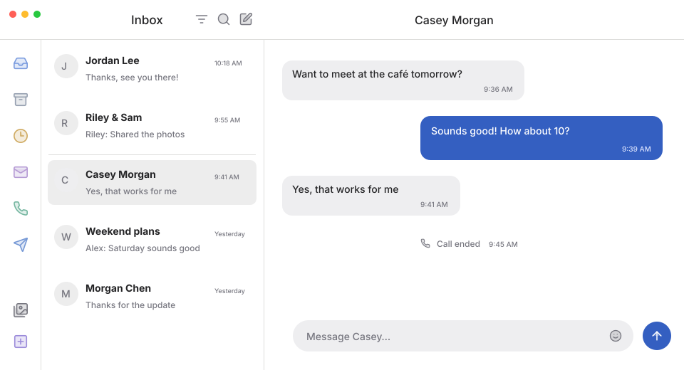
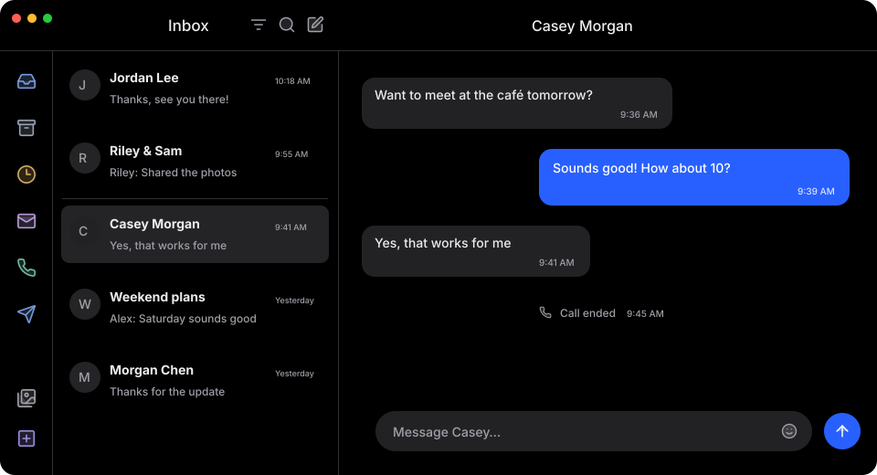

# Beeper — Devon’s version

A personal theme for Beeper Desktop: quieter chat previews, coordinated duotone icons, a shared header, compact quoted replies, and white / true-black backgrounds that follow your computer’s appearance.




These previews use fictional conversations and illustrate the theme; they are not screenshots of a real inbox.

## Install

1. Download [`custom.css`](custom.css) or clone this repository.
2. In Beeper, open **Settings → Appearance → Custom CSS → Open CSS file in editor**.
3. Back up your existing CSS, then replace its contents with this theme.
4. Click **Reload CSS**. Set Beeper’s appearance to **System** to follow your computer’s light / dark mode.

On macOS, from a local clone:

```sh
./scripts/install.sh
```

The installer backs up the existing stylesheet before copying this one to `~/Library/Application Support/BeeperTexts/custom.css`. Reload CSS in Beeper afterward. Nothing is installed or run inside Beeper besides the stylesheet.

## What’s included

- White light-mode surfaces and true-black dark-mode surfaces.
- A narrow account ribbon with coordinated duotone icons and circular selection backgrounds.
- Muted network icons inline with chat previews; compact icon-only attachment labels.
- Rounded selected chats, pinned-group separation, and restrained timestamps.
- Quoted messages inside a shared reply bubble; wider message text and side-positioned reply / reaction controls.
- Selection outlines, compact hover actions, subtle received-bubble edges, and centered system notices.
- Composer placeholders with a bold chat name and lighter surrounding text.
- Compact chat-list dates such as `1d`, `Wed`, and `12:20am`.

The current file preserves the accumulated theme exactly as used on November 9, 2026. Some rules intentionally override earlier ones, so **order matters**. Refactoring can happen in separate, reviewable commits without losing this baseline.

## Save a change

If you edited the installed Beeper stylesheet, run this from the repository:

```sh
./scripts/save.sh "Describe the change"
```

This imports the installed CSS, commits only `custom.css`, and pushes the commit to GitHub. It requires Git and a working GitHub login. It does not publish other files from your computer. If the push fails, the local commit remains available; run `git push` after restoring access.

Alternatively, edit `custom.css` in this repository, run `./scripts/install.sh`, reload Beeper’s CSS, then commit and push after checking the result.

## Retrieve an earlier version

- Use GitHub’s **History** view to inspect individual changes.
- Download a named version from **Releases** for a stable snapshot.
- To test a previous commit without moving your branch:

  ```sh
  git show COMMIT:custom.css > /tmp/beeper-previous.css
  ./scripts/install.sh /tmp/beeper-previous.css
  ```

  Reload CSS to apply it. Run `./scripts/install.sh` without an argument to return to the repository’s current version.

## Compatibility and settings

Built and iterated on **macOS with Beeper Desktop 4.3.284**. Beeper updates can change internal class names and icons, so some customizations may need adjustment. The core CSS may work elsewhere, but the installer and some icon replacements are macOS-specific.

Some personal preferences are Beeper settings, not theme CSS. For example, to move recording into the **+** menu, set **Appearance → Composer → Secondary composer button → None**. Those settings are not exported here.

This theme changes presentation only. It does not read, send, or export messages. The repository contains no chat history or private screenshots.

## Credits and license

Original theme code is available under the [MIT license](LICENSE). Lucide artwork is covered by its ISC license, and the embedded Inter-derived placeholder font by the SIL Open Font License; see [third-party notices](THIRD_PARTY_NOTICES.md). Network names and logos belong to their respective owners. This project is unofficial and is not affiliated with Beeper.

### Maintaining the placeholder font

Beeper exposes the placeholder as one string, so CSS cannot wrap only the name in a bold span. A small embedded font uses contextual substitutions to render characters after “Message ” in bold, stopping before the network suffix. This applies only to the placeholder; drafts, accessibility text, and other app text retain their original behavior. No runtime script or external font request is needed. Unsupported characters use the ordinary font fallback.

To rebuild it, install `fonttools[woff]` and `uharfbuzz` in a development Python environment, then run `python scripts/build-placeholder-font.py /path/to/Inter-Medium.woff2 /path/to/Inter-Bold.woff2` with matching static Inter fonts. The script checks name emphasis on fictional individual, group, and accented names and replaces the embedded font block in `custom.css`.

The timestamp font uses the same approach to shorten English labels visually while preserving their full underlying text. Rebuild it with `python scripts/build-date-font.py /path/to/Inter-SemiBold.woff2`. This verifies day abbreviations, AM/PM suffixes with common space variants, and unchanged numeric dates. Other languages retain their ordinary text.
